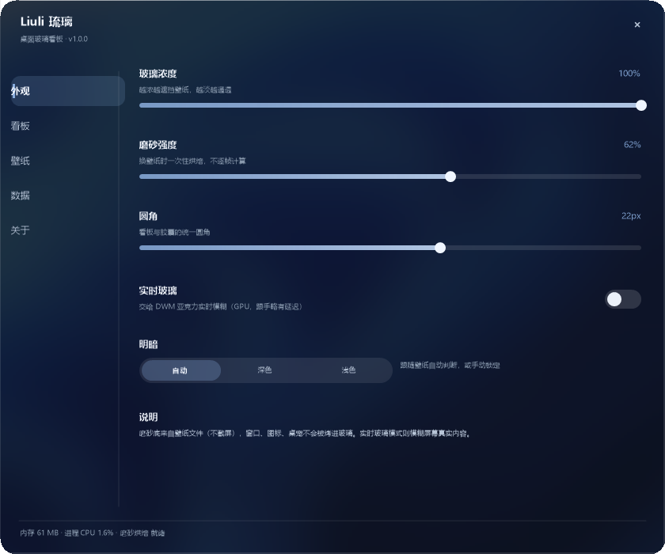

# Liuli 琉璃

把 Windows 桌面变成一块会呼吸的玻璃看板。

Liuli 不是“壁纸 + 小组件”的堆叠，而是把桌面本身当成一层可自由划分的透明看板：你可以随手拖出一块块玻璃，分别放便签、待办、文件入口、代码片段、天气与系统状态、时钟。所有内容保存在本地，断网也能用。

- 轻量：单 exe，无安装器、无捆绑、无外部 DLL
- 低占用：真机常驻内存约 53MB，闲置 CPU 约 0.4%（单核百分比）
- 玻璃底来自壁纸文件本身，不截屏，不会把窗口/图标烤进玻璃
- 完全离线：天气是可选增强，失败自动退回缓存




## 功能

- 六类看板：便签 / 待办 / 文件 / 代码 / 状态（天气 + CPU/内存/磁盘）/ 时钟
- 自由拖拽、八方向缩放、磁吸对齐、折叠、置顶、锁定、配色
- 玻璃拟态：圆角、顶边高光、上下渐变描边、强调色呼吸、噪点防色带
- 一键把桌面图标按类型收进看板（只建入口，不移动/删除桌面文件）
- 动态壁纸：图片走系统壁纸通道（零常驻开销），视频走 WMP 控件挂桌面壁纸层（GPU 解码，全屏自动暂停）
- 备份：一键导出/导入 zip；原子写入，坏文件自动另存 `.broken-*`
- 设置面板本身也是一块玻璃；无弹窗广告，托盘可退出

## 运行要求

- Windows 10 1903 及以上 / Windows 11 全版本
- .NET Framework 4.x（系统自带）
- 视频壁纸需要系统 Media Feature Pack；缺失时自动退回静态壁纸

## 构建

```powershell
pwsh -File tools\build.ps1          # 产出 bin\Liuli.exe
pwsh -File tools\build.ps1 -Run     # 构建并启动
```

编译使用系统自带的 `csc.exe`（C# 5 语法），不依赖 Visual Studio。构建脚本会先把 `src\*.cs` 统一转成 UTF-8 BOM，再编译，避免中文乱码。

## 目录

```
src\            全部源码（一个 exe，零外部依赖）
tools\build.ps1 构建脚本（补 BOM + csc）
docs\           设计说明、测试记录、变更日志、截图
bin\            构建产物（data\ 为运行时数据，均不入库）
```

运行时数据在 `bin\data\`：`boards.json`、`weather.json`、`logs\liuli.log`、`backups\`、`icons\`。

## 快捷键

- `Ctrl+Alt+L` 显示/隐藏所有看板
- `Ctrl+Alt+G` 打开设置
- 双击桌面控制条也能开设置

## 已知边界

- 看板是分层窗口，不能直接输入文字；编辑交给独立普通窗口，保证中文输入法正常
- “实时玻璃”使用 DWM 亚克力，部分 Win10/显卡驱动上可能不可用，失败时自动使用壁纸烘焙底
- 隐藏桌面图标是系统开关，退出 Liuli 会恢复
- Win10 1903、多 DPI、无 Media Feature Pack 环境尚未真机验证，见 `docs/TESTING.md`

## 许可

MIT。第三方参考仅限机制与参数，代码按本项目架构独立实现。
