# Liuli 琉璃

> **v2.0 重构进行中。** 产品基线已确认为 GlassBoard 功能对齐（Dock + 顶部灵动岛 + 玻璃面板 + 桌面组件），见 [docs/REQUIREMENTS.md](docs/REQUIREMENTS.md)。M1 已实现底部 Dock、顶部灵动岛、任务栏自动隐藏与 `shell.json` 独立配置；M2 已补 Dock 自动隐藏、三档尺寸、运行指示、拖拽排序与悬停放大，并通过 PR #49 合入 `main`；M3 已补灵动岛尺寸/偏移/动画/内容开关配置，并通过 PR #51 合入 `main`；M4 玻璃面板已通过 PR #53 合入 `main`；REQ-032 主题快照与 v2 集中设置面板在 Issue #54 完成，已通过 PR #55 合入（`0dc1a6a`）。M5 桌面图标（REQ-080–082/Issue #61）已通过 PR #62 合入；TASK-054 桌面收纳单面板（Issue #16）已完成并真机验收，已通过 PR #63 合入（`dc2ef27`）；TASK-050 时钟/天气/系统组件（Issue #64）已通过 PR #65 合入（`5a1b1a2`）；M6 开机自启（Issue #66）已通过 PR #67 合入（`812661f`）；TASK-063 热键状态/重置（Issue #68）已通过 PR #69 合入（`ea378c0`）；TASK-064 日志诊断（Issue #70）已通过 PR #71 合入（`9851d21`）；TASK-065 Dock 任务栏避让（Issue #72）已通过 PR #73 合入（`8b00fb2`）。TASK-062 文字四档（Issue #74）已通过 PR #75 合入（`47204c5`）；TASK-070a 多屏模式第一步（Issue #76）已通过 PR #77 合入（`e4628c6`）；TASK-071 应用面板与控制中心（Issue #78）已通过 PR #79 合入（`1c19d51`）；TASK-070b 副屏任务栏感知与跨屏玻璃（Issue #80）已通过 PR #81 合入（`7cc91ca`）；TASK-070c 每屏独立 Dock 图标布局（Issue #82）已通过 PR #83 合入（`0cc8cb7`）；TASK-070d 每屏 Dock 布局收口（Issue #84）已通过 PR #85 合入（`80c2b3a`）；TASK-042 导入推荐配置（Issue #99）已通过 PR #100 合入（`4762eb4`）。v1.5.0 的“看板 + 文件收纳”功能整体封存，保留代码与用户数据，不再默认创建窗口。

## v2.0 M1–M5 当前能力

- 底部玻璃 Dock：默认 3 个系统入口（此电脑 / 回收站 / 用户文件夹）+ 5 个内置应用（资源管理器 / 设置 / Edge / 记事本 / 计算器）；缺失程序自动跳过。
- Dock 支持左键启动、拖入文件/快捷方式固定（COPY，不移动源文件）、右键移除；配置存 `bin\data\shell.json`。
- Dock 可在托盘切换常显/自动隐藏；自动隐藏时底部热区唤出，离开约 650ms 收起，滑入/滑出 170ms。
- Dock 三档尺寸：小 / 标准 / 大，整体缩放 0.86 / 1.0 / 1.14；托盘/快捷菜单循环切换。
- Dock 运行指示：已运行的 exe 应用图标下方显示 accent 小圆点；每 2s 缓存刷新，`.lnk` 暂不解析。
- Dock 拖拽排序：按住图标移动超过 8px 进入排序，accent 竖线提示插入位，松手保存顺序。
- Dock 悬停放大：指针进入后 140ms 放大到 1.08，移出恢复；按下仍缩到 0.94。
- Dock / 灵动岛点击反馈：按下缩放与按压底色，释放回弹 + accent 波纹；Dock 应用图标取 256px Shell 图像，`.lnk` 先解析目标再按不透明内容裁边铺满，避免小图标缩成点。
- Dock 右侧四个动作按钮：桌面收纳 / 应用面板 / 控制中心 / 设置；桌面收纳按钮是开关键，打开时从哪块屏的 Dock 点开就居中贴在那一屏 Dock 上方 8px，再点一次或点桌面/其它位置收起（收起写回配置，重启不自动弹出）。收纳始终按 Dock 实际顶边锚定，启动、DPI 重排、设置开启、Dock 拖动都会立即跟随；标题区不允许拖动。
- Dock 位置：默认关闭自动隐藏，固定在任务栏上方常驻；设置 Dock 页可调“距底部”（默认 8px，0–160px），默认水平居中。解锁“锁定 Dock 位置”后，顶部把手或 Dock 空白处可拖动到任意位置，坐标存 `dockCustomX/Y`；“回到居中”清空自定义坐标。旧 `dockAlign` 只在读取时兼容，新写入统一 `center`。任务栏露出时 Dock 等 300ms 稳定后上移，避免两者在屏幕底边互相触发闪动。
- 任务栏完全隐藏（运行期开关）：设置 Dock 页可隐藏主/副任务栏，Dock 与托盘仍可用；关闭或退出 Liuli 自动恢复，重启不延续。
- DPI 变化重排：收到 `WM_DPICHANGED` 后合并重排 Dock、灵动岛、收纳、Hub、设置与面板，避免缩放比例往返后尺寸漂移。
- 顶部灵动岛：收起显示时间/天气；悬停展开日期、天气、CPU/内存/磁盘与三个快捷动作。
- 灵动岛媒体（SMTC）：有当前媒体会话时展开态多出一行媒体信息（标题/歌手/进度条），右侧上一首 / 播放暂停 / 下一首；无会话自动隐藏，不占高度。设置·灵动岛页可关“媒体信息”；后台 0.9s 轮询，标题/播放状态变化才通知重绘，进度由既有 1s 展开重绘刷新。
- 灵动岛通知摘要：后台只读系统通知库 `wpndatabase.db` 的 toast 文本，展开态显示最新一条（应用名、标题、正文、未读数量），右侧 × 忽略当前条、扫帚清除岛内全部摘要；同应用同标题同正文不重复展示，无通知或关闭“通知摘要”时整行隐藏。只读正文文本，不读图片/附件，不写回系统通知库；清除水位存 `shell.json`，重启不再翻旧通知。
- 灵动岛可配置：宽度 360–520、高度 100–180、顶部偏移 0–80、展开动画 0–400ms，以及天气/系统读数/媒体信息/通知摘要/快捷动作开关；托盘菜单“灵动岛设置”按档位循环，支持恢复默认，配置存 `shell.json`。
- 玻璃面板：最多 6 个；按住拖动、右下角缩放、右键切换空容器/时钟/天气/系统内容，支持置顶/置底与删除；设置·面板页或右键菜单可“锁定所有面板位置”，锁定后拖动与缩放都不响应；布局存 `panels[]`，透明区点击穿透。
- 时钟组件：右键支持 24/12 小时制与秒显示开关；12 小时制显示上午/下午，秒开启时每秒刷新。天气离线且保留缓存时标注“离线缓存”；系统面板按 2 秒刷新 CPU/内存/磁盘。
- 主题快照：最多 6 个，保存/覆盖/加载/删除；快照包含 Dock、灵动岛、玻璃参数、明暗、壁纸路径与压暗、面板布局，加载后恢复整套桌面外观。
- 推荐配置导入：设置·主题页选择 JSON，先全量校验 `theme` / `dock` / `island` / `panels`，通过后备份 `shell.json` 到 `data\backups\`，再一次性应用；非法字段按路径列出，失败不改当前状态；示例 `docs/examples/recommended-config.json`。
- v2 集中设置面板：900×720 玻璃十页（主题 / 配色 / 面板 / Dock / 灵动岛 / 壁纸 / 桌面 / 收纳 / 系统 / 关于），滑杆与开关即时生效；Dock 齿轮、灵动岛齿轮、托盘点按、`Ctrl+Alt+G` 都进入设置，上下文入口分别落到 Dock / 灵动岛页。
- 配色：强调色支持跟随壁纸、6 套内置预设（雾蓝/青瓷/紫雾/暖砂/绯红/石墨）与自定义取色，统一写入 `Theme.Accent`；主题快照会一并保存和恢复。
- 壁纸页：当前壁纸预览、本地图片替换、0–80% 压暗、恢复首次换图前的系统壁纸；压暗会进入玻璃底重烘与主题快照。
- 桌面页：启动默认隐藏全部桌面图标（运行期状态，退出恢复），并分别控制此电脑/回收站/用户文件夹/网络/控制面板五个系统图标；不删除文件或快捷方式。Windows 11 25H2 已不绘制控制面板桌面图标，开关会写偏好但可能看不到图标。
- 桌面收纳：单面板 + 分组标签，只保存原路径，不移动/复制/删除桌面文件；自动扫描用户桌面与公共桌面，新文件 2 秒轮询、5 秒内可见；按扩展名、文件夹、`data\groups.txt` 自动分组；双击打开、面板内拖动换组、拖入加入口、右键移出；拖出到资源管理器只允许 Copy。设置新增“收纳”页，可开关、重扫、恢复移出和打开面板。
- 系统页：设置第 10 页提供开机自启开关，写当前用户 `HKCU\Software\Microsoft\Windows\CurrentVersion\Run\Liuli`；移动 exe 后下次启动自动修正路径，关闭即删除；不写 HKLM、不需要管理员权限。
- 系统页显示 `Ctrl+Alt+L` / `Ctrl+Alt+G` 的实际注册状态；组合被占用时显示“失败”，可点“重新注册快捷键”重试，日志记录 `hotkey toggle/settings` 结果。
- 系统页日志诊断：显示当前日志和 `.1` 轮转大小，可打开日志目录或复制含版本、DPI、路径和最近 16 行的诊断摘要；日志超过 512 KB 自动轮转。
- 文字大小：设置标题栏常驻“小 / 标准 / 大 / 特大”四档（0.9 / 1.0 / 1.15 / 1.3），切换后 Dock、灵动岛、面板、收纳、设置即时等比缩放并持久化；0.9 档正文最小按 8px 绘制。
- 多屏模式：设置 Dock 页可切“仅主屏 / 所有屏”；所有屏时每块副屏各一套 Dock，默认共享图标配置，每屏 Dock 只在本屏底部热区唤出；可开“每屏独立布局”，副屏首次排序/移除/固定时复制共享列表并单独保存，关闭只停用、布局保留。
- 副屏任务栏：每块 Dock 按所在屏识别 `Shell_TrayWnd` / `Shell_SecondaryTrayWnd`，本屏任务栏露出时同步上移并保持 8px 间距；`HideAll/ShowAll` 覆盖全部任务栏实例。
- 跨屏玻璃：多屏时壁纸磨砂底按虚拟屏连续铺一张，再按窗口屏幕矩形切片，跨两屏的玻璃纹理不断开；单屏仍按系统壁纸样式。
- 应用面板：Dock 文件夹按钮或托盘“应用面板”打开，扫描开始菜单 99 个入口，4×4 网格分页、搜索、左键启动；右键或按住拖到 Dock 可固定，松手后自动收起。
- 控制中心：Dock 脉冲按钮或托盘“控制中心”打开，显示音量/静音、网络、蓝牙、亮度；音量可点击静音与滚轮 4% 步进，网络/蓝牙打开系统设置，亮度循环 25/50/75/100；接口不可用时对应卡片隐藏，不引入常驻服务。
- 任务栏自动隐藏可切换、可恢复；Dock 用 55ms 定时检测任务栏是否真正露出，露出时整体上移任务栏高度，缩回后回到底部，避免遮挡任务栏或抢任务栏唤出热区。
- 托盘与热键：`Ctrl+Alt+L` 显示/隐藏外壳，`Ctrl+Alt+G` 打开设置。
- 无界面自检：`Liuli.exe --selftest` 读取配置、任务栏状态并探测 256px 图标，不启动窗口。


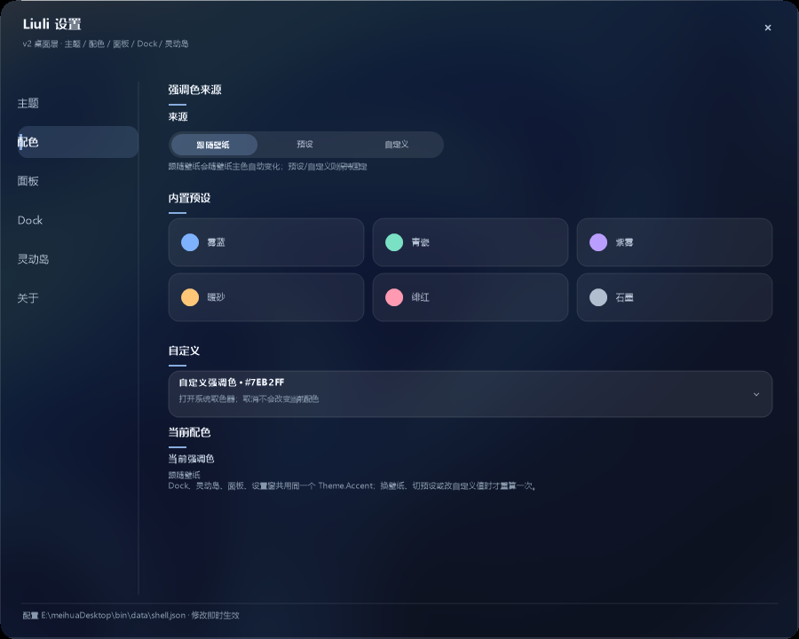


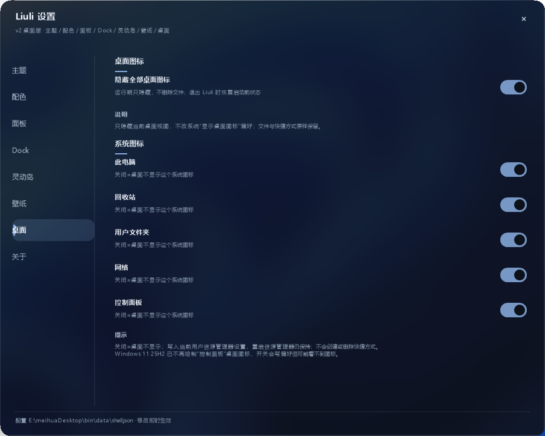

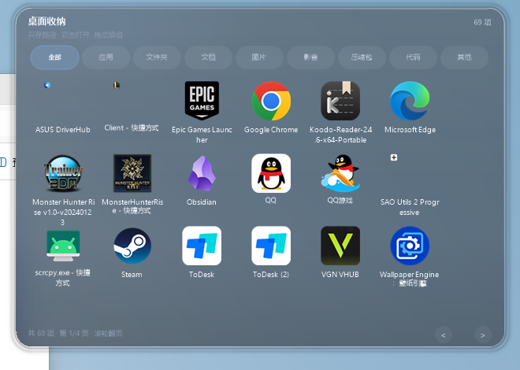


- 系统页：开机自启、热键状态与日志诊断。

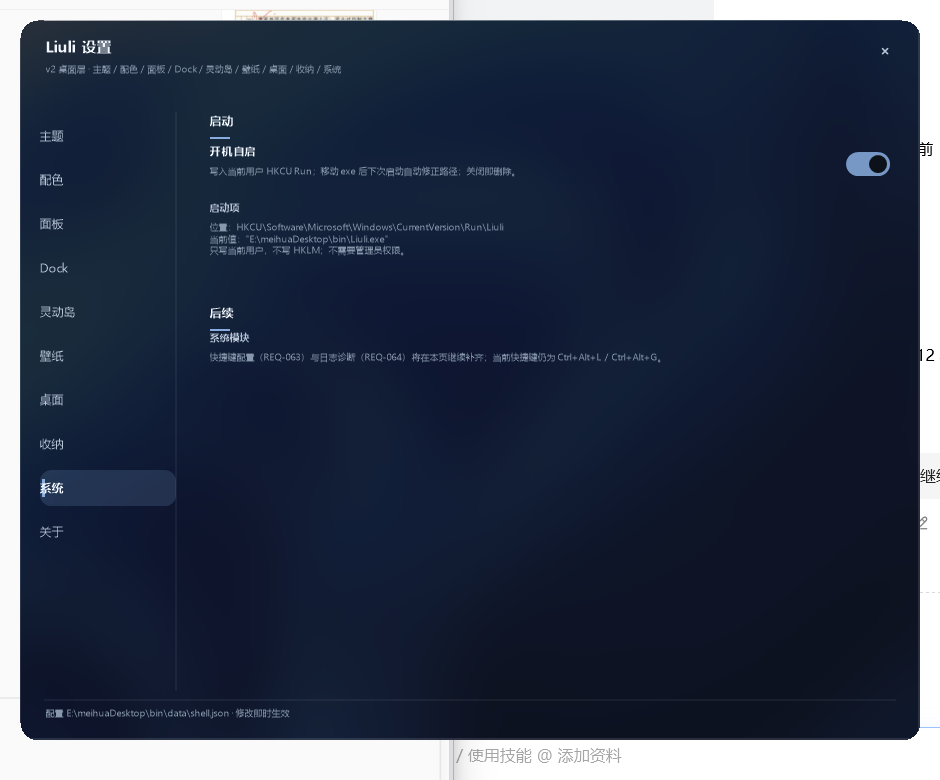

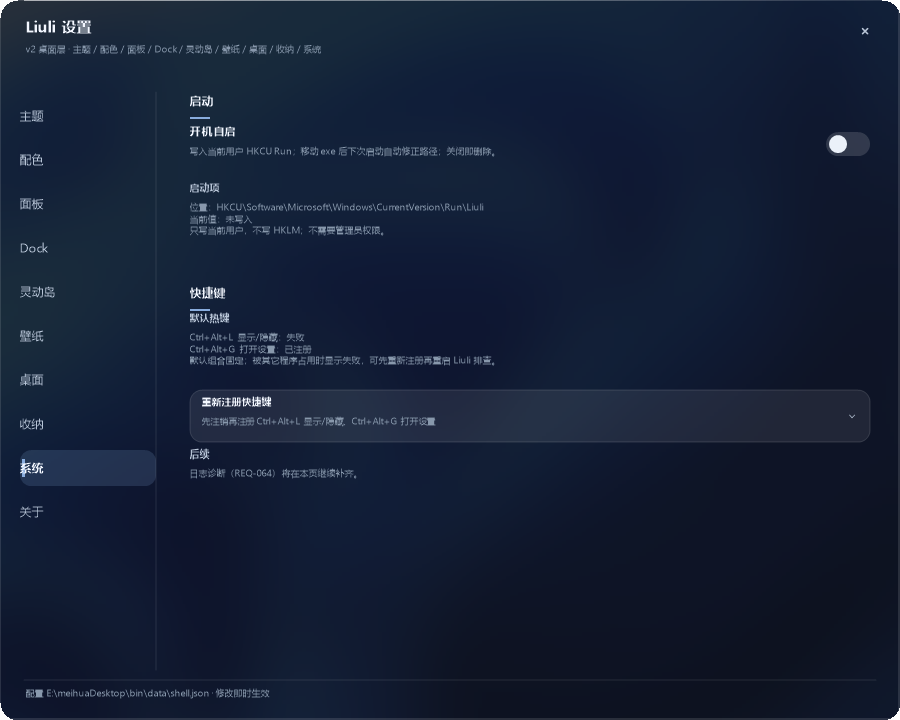

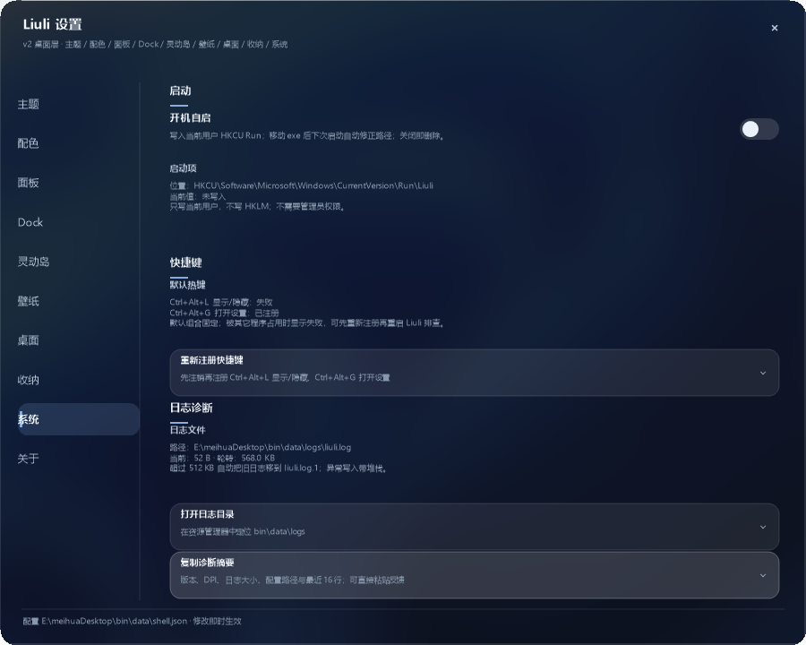

- 文字特大（1.3 档）设置页与收纳面板，标题栏四档切换。

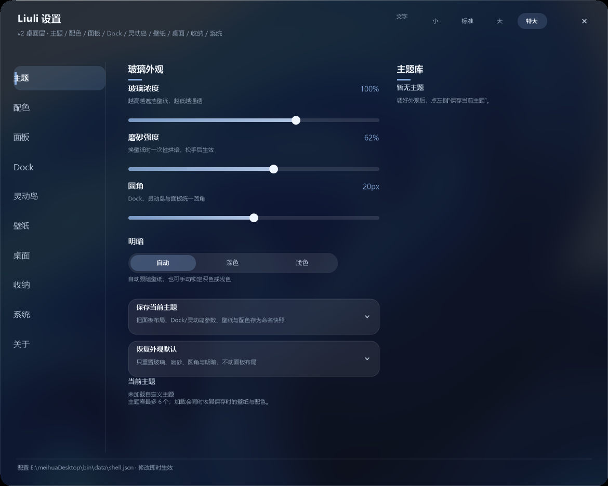

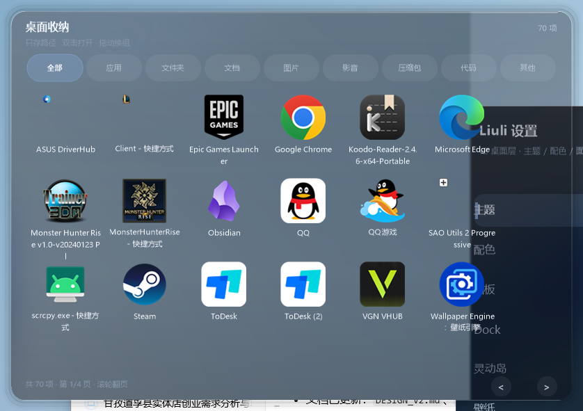

- Dock 与任务栏同时露出时的避让效果（测试时临时关闭 Dock 自动隐藏）。

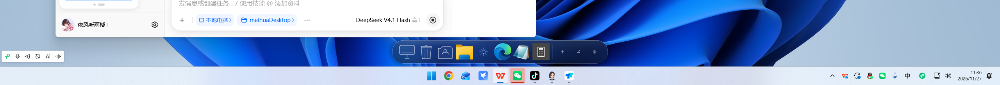

- 灵动岛通知摘要：最新 toast 的应用名、标题、正文与未读数量；× 忽略当前条，扫帚清除岛内摘要；与媒体行同时存在时各占 40px。

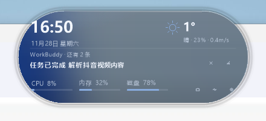

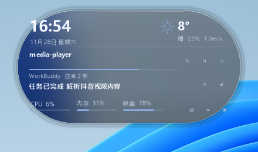

尚未进入的能力：设置的分模块余项（M6）、面板/收纳的每屏独立组合（Dock 每屏布局已落地）；M2 仍待验 125% DPI、外部文件拖入 Dock、2s 枚举 CPU 长时占用；通知摘要的系统通知中心联动清除仍待定。

## v1.5.0 旧功能（已封存）

把 Windows 桌面变成一块会呼吸的玻璃看板。

Liuli 不是“壁纸 + 小组件”的堆叠，而是把桌面本身当成一层可自由划分的透明看板：你可以随手拖出一块块玻璃，分别放便签、待办、文件入口、代码片段、天气与系统状态、时钟。所有内容保存在本地，断网也能用。

- 轻量：单 exe，无安装器、无捆绑、无外部 DLL
- 低占用：真机常驻内存约 57MB，闲置 CPU 约 0.06%（单核百分比）
- 玻璃底来自壁纸文件本身，不截屏，不会把窗口/图标烤进玻璃
- 完全离线：天气是可选增强，失败自动退回缓存


## 功能

- 六类看板：便签 / 待办 / 文件 / 代码 / 状态（天气 + CPU/内存/磁盘）/ 时钟
- 自由拖拽、八方向缩放、磁吸对齐、折叠、置顶、锁定、配色
- 玻璃拟态：圆角、顶边高光、上下渐变描边、强调色呼吸、噪点防色带
- 文件看板是图标网格：缩略图在上、文件名在下，接近酷呆/Fences 的盒子；单击打开，按住拖到资源管理器即移出
- 每块文件看板绑定一个收纳目录（默认 `文档\Liuli\<看板标题>`）；在资源管理器里新增/删除/重命名，看板约 4 秒内自动对齐
- 一键把桌面图标按类型收进看板（默认只建入口，不移动/删除桌面文件）；可选「整理时移动原件」，把文件真实移进 `文档\Liuli\<分组>`、桌面不留副本；收纳根可在「数据 → 收纳位置」改，两种方式都支持撤销上次整理
- 自定义分组：`data\groups.txt` 按 `扩展名=分组` 覆盖默认归类（应用 / 文件夹 / 文档 / 图片 / 影音 / 压缩包 / 代码 / 其他），重启后生效
- 动态壁纸：图片走系统壁纸通道（零常驻开销），视频走 WMP 控件挂桌面壁纸层（GPU 解码，全屏自动暂停）
- 备份：一键导出/导入 zip；原子写入，坏文件自动另存 `.broken-*`
- 开机自启：设置里一键开关，写当前用户 `Run` 项；启动时按配置自动校准注册表，移动 exe 后仍指向新路径
- 设置面板本身也是一块玻璃；无弹窗广告，托盘可退出

## 运行要求

- Windows 10 1903 及以上 / Windows 11 全版本
- .NET Framework 4.x（系统自带）
- 视频壁纸需要系统 Media Feature Pack；缺失时自动退回静态壁纸

## 构建

```powershell
pwsh -File tools\build.ps1          # 产出 bin\Liuli.exe
pwsh -File tools\build.ps1 -Run     # 构建并启动
```

编译使用系统自带的 `csc.exe`（C# 5 语法），不依赖 Visual Studio。构建脚本会先把 `src\*.cs` 统一转成 UTF-8 BOM，再编译，避免中文乱码。

## 目录

```
src\            全部源码（一个 exe，零外部依赖）
tools\build.ps1 构建脚本（补 BOM + csc）
docs\           设计说明、测试记录、变更日志、截图
bin\            构建产物（data\ 为运行时数据，均不入库）
```

运行时数据在 `bin\data\`：`boards.json`、`weather.json`、`logs\liuli.log`、`backups\`、`icons\`；可选 `groups.txt`（自定义图标分组）。收纳文件默认放 `文档\Liuli\<看板标题>`（可在设置「数据 → 收纳位置」改），桌面不再多一个 Liuli 文件夹。整理时写 `undo-organize.json`（撤销用，撤销后自动删除）；开启「整理时移动原件」时另有 `move-manifest.json`（原路径→新路径，撤销全部成功后自动删除）。

## 文档

- [文档目录索引](docs/目录索引.md)
- [需求基线](docs/REQUIREMENTS.md)
- [v2 设计](docs/DESIGN_V2.md)
- [任务与 M1/M2 状态](docs/TASKS_V2.md)
- [测试与未验证项](docs/TESTING.md)
- [踩坑记录](docs/踩坑记录.md)

## 快捷键

- `Ctrl+Alt+L` 显示/隐藏所有看板
- `Ctrl+Alt+G` 打开设置
- 双击托盘图标也能开设置

## 已知边界

- 看板是分层窗口，不能直接输入文字；编辑交给独立普通窗口，保证中文输入法正常
- “实时玻璃”使用 DWM 亚克力，部分 Win10/显卡驱动上可能不可用，失败时自动使用壁纸烘焙底
- 隐藏桌面图标是系统开关，退出 Liuli 会恢复
- Win10 1903、多 DPI、无 Media Feature Pack 环境尚未真机验证，见 `docs/TESTING.md`

## 许可

MIT。第三方参考仅限机制与参数，代码按本项目架构独立实现。
